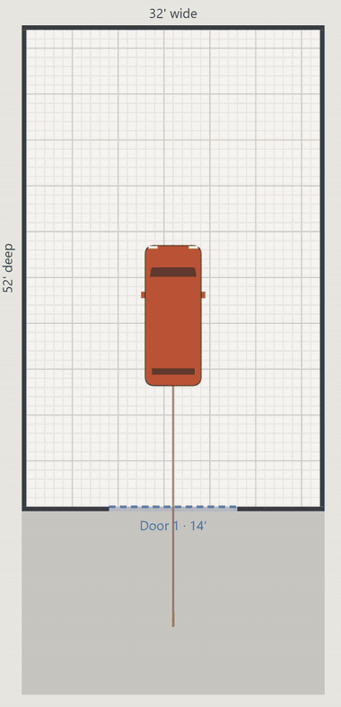
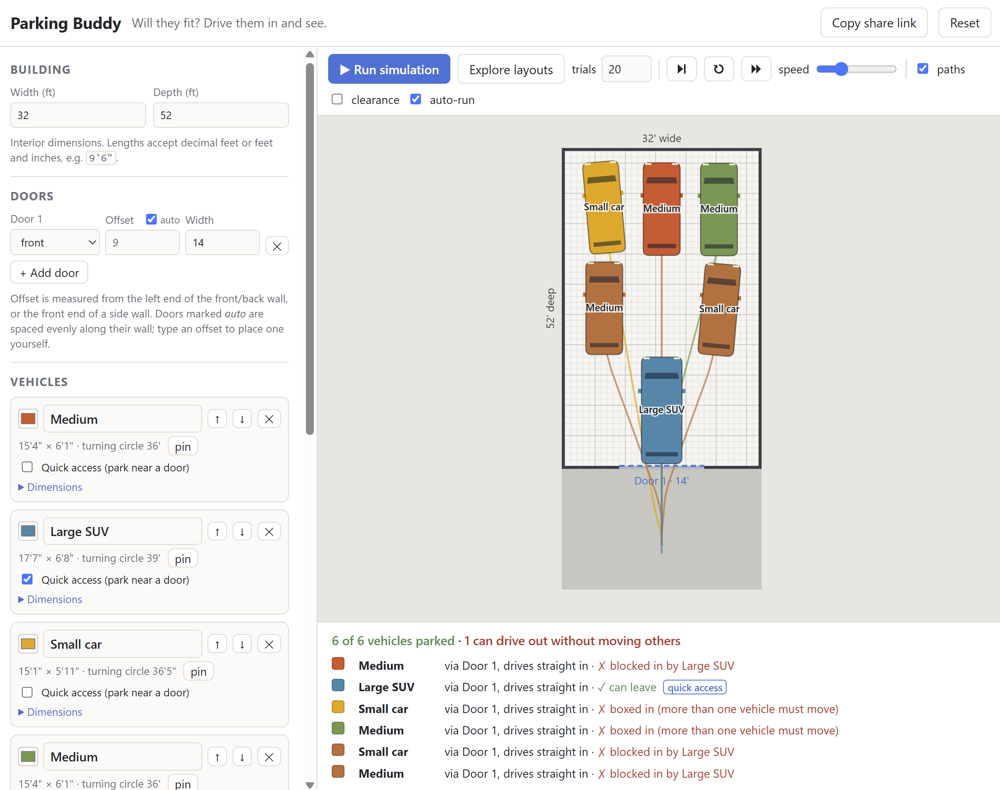

# Parking Buddy

[](https://github.com/dboreham/parking-buddy/actions/workflows/ci.yml)

Will your vehicles fit in the garage or barn you're planning? Parking Buddy lets
you set the building size and doors, pick some vehicles, then simulates driving
each one in. Each vehicle steers within its real turning circle, keeps clearance
from walls, door jambs and other vehicles, and backs up when it needs to.

<p align="center">
  
</p>

<p align="center">
  
</p>

It's a static web app: plain HTML, CSS and ES modules with no build step and no
dependencies.

## Running

Serve the directory over HTTP. Opening `index.html` as a `file://` URL won't
work, because the planner runs in a module Web Worker.

```sh
npm start            # tiny Node static server (tools/serve.mjs), no install needed
# open http://localhost:8000
```

Any static server works too, e.g. `python3 -m http.server 8000`.

To deploy, copy `index.html`, `css/` and `js/` to any static host.

Or deploy it as a container with [stack](https://github.com/bozemanpass/stack).
The stack in `stack/` serves those same files with nginx via the `static-content`
wrapper; `.dockerignore` limits the image to them:

```sh
stack build containers --stack ./stack
stack init --stack ./stack --output parking-buddy-spec.yml --deploy-to compose --map-ports-to-host any-same
stack deploy --spec-file parking-buddy-spec.yml --deployment-dir ./parking-buddy-deployment
stack manage --dir ./parking-buddy-deployment start   # serves on port 80
```
Parking Buddy is also hosted at [parking.stack.servesthe.world](https://parking.stack.servesthe.world/)

## Using it

- **Building**: interior width and depth. Lengths accept `9.5`, `9'6"`, `9 ft 6 in` or `114"`.
- **Doors**: any number, on any wall. Each has an offset along the wall and a width.
- **Vehicles**: start from a preset (compact car, compact SUV, large SUV, crew-cab
  pickup, sports car) and edit the dimensions. Use the spec-sheet *curb-to-curb
  turning circle*, and the width across the mirrors. Mirrors are often what
  decides whether a vehicle gets through a door. Tick **Quick access** on any
  vehicle you need out fast, or one that comes in covered in snow. It is parked
  last, as near a door as possible with a clear way out, even if that blocks
  others in.
- **Obstacles**: posts, benches, stairs, as rectangles.
- **Rules**: clearance while moving, the side gap needed to open doors when parked,
  the end gap, the driveway apron depth, whether angled parking is allowed, and
  whether to try to keep every vehicle free to leave.

**Run simulation** parks the vehicles in list order and animates them.
**Explore layouts** tries many random parking orders and spot choices, then keeps
the best result. "Best" means, in order:
1. the most vehicles parked;
2. quick-access vehicles able to drive straight out;
3. the most vehicles that can leave without moving anything;
4. quick-access vehicles as close to a door as possible;
5. the fewest manoeuvres.

To tell it where you want a vehicle, **drag it on the plan**. That pins it. Scroll
the mouse wheel over a vehicle to rotate it 5° (hold Shift for 15°), or press `R`
to rotate it 90°. Pinned vehicles are parked first, and the others work around
them. With *auto-run* on, every change re-plans right away.

**Copy share link** puts the whole setup in the URL. The setup is also saved in
the browser's local storage.

## How it works

- `js/planner.js`: a Hybrid-A*-style search over (x, y, heading) using a
  kinematic bicycle model. The minimum radius at the rear axle comes from the
  curb-to-curb turning circle. Motion primitives go forward and in reverse, at full
  and half steering lock, and each turns by exactly one 5° heading bin, so
  headings stay exact. The search runs as a Dijkstra flood from entry poses
  outside each door, which finds every pose the vehicle can reach in one pass.
  Costs penalise reversing, steering and changing direction.
- `js/layout.js`: parks vehicles one at a time. For each one, it scores every
  reachable pose that meets the spacing rules, then picks the best. The score
  rewards being deep in the building, snug against walls and other vehicles, and a
  simple manoeuvre. It penalises blocking door lanes or earlier vehicles' paths.
  Afterwards it checks that each vehicle can drive out. It first tries reversing
  the vehicle's own entry path; if that's blocked, it searches. It also reports
  which vehicle is in the way.
- `js/explore.js`: random-restart search over parking order and spot choice.
- `js/render.js`, `js/main.js`: canvas drawing, UI, animation, drag-to-pin.

## Limitations

- The model is 2D only. Overhead doors, lifts and roof posts are not checked for height.
- The planner works on a 0.5 ft / 5° grid. In very tight spots (less than about
  0.25 ft spare) it can miss a manoeuvre that exists, so treat "doesn't fit" there
  as "very tight".
- The automatic layout is heuristic. Use *Explore layouts* or pins to look for
  better arrangements.

## Tests

Unit tests use Node's built-in runner and need no install (any current Node LTS):

```sh
npm test       # geometry, vehicle model, walls/doors, planner, layout, explore
npm run bench  # prints the layout and timing for each scenario in test/scenarios.mjs
```

The layout tests include an invariant check. For every scenario, each planned
path is replayed and must:
- be continuous;
- never turn tighter than the vehicle's minimum radius;
- never touch a wall, an obstacle or an already-parked vehicle (with clearance);
- end in a spot that meets the spacing rules.

Browser tests drive the real page in headless Chromium with
[Playwright](https://playwright.dev). They cover planning, animation, doors,
drag-to-pin, share links, explore and the phone layout:

```sh
npm install
npx playwright install --with-deps chromium   # once; --with-deps uses sudo for system libraries
npm run test:e2e
```

Playwright starts `tools/serve.mjs` on port 8123 itself. The page exposes a
read-only `window.__parkingBuddy` hook, used by these tests to locate vehicles
on the canvas and see what's drawn.

## Provenance

Parking Buddy was mostly created by Claude Code using Opus 5.5. The session transcript is [here](https://codeassociates.github.io/conversations-with-claude/conversations/side-projects/parking-buddy/index.html).
